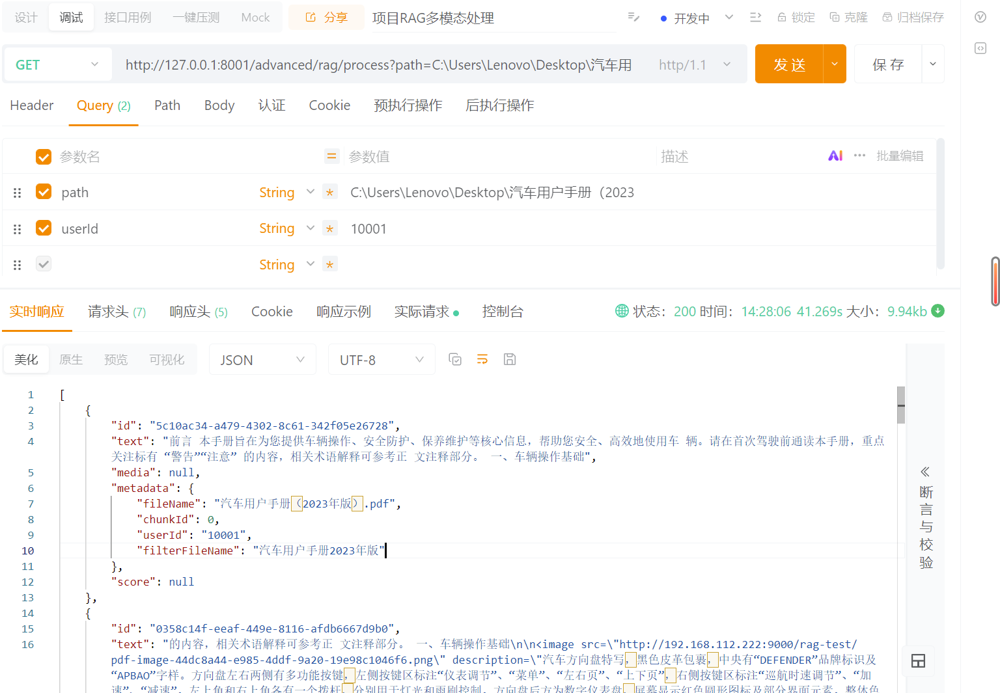
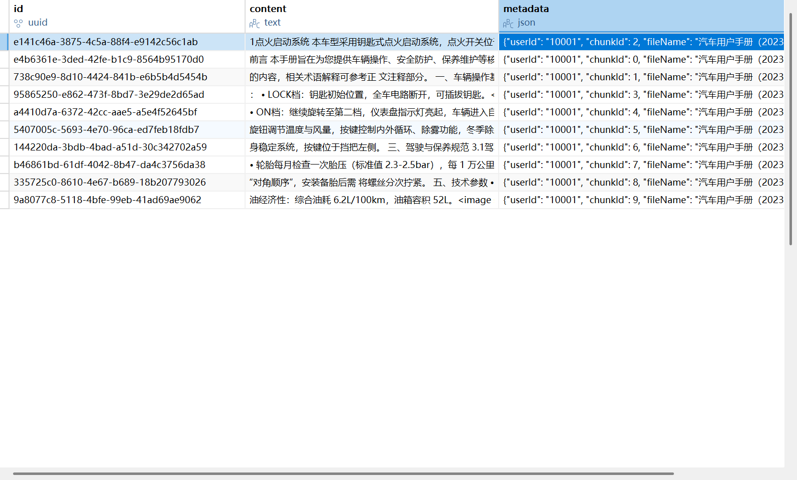
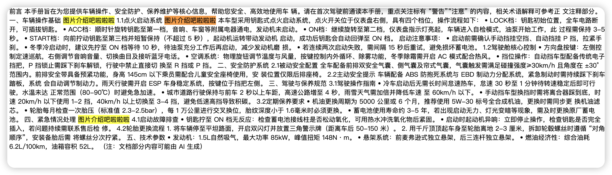
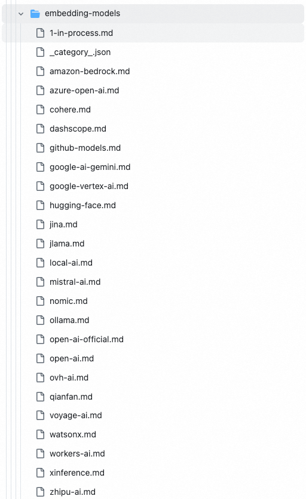
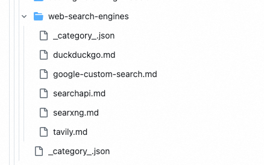
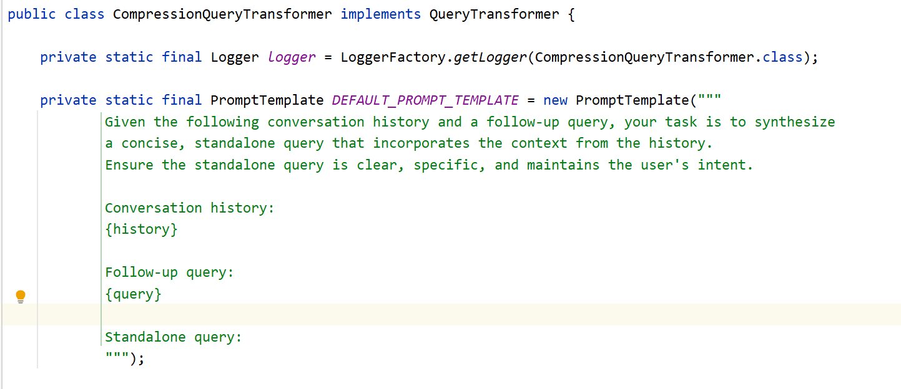
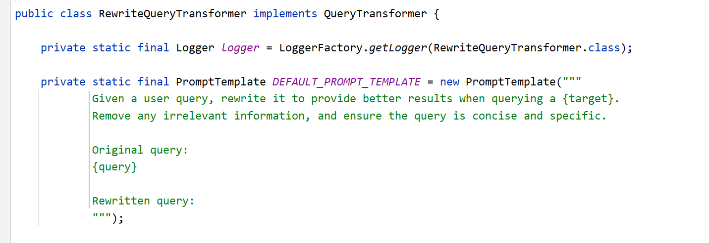
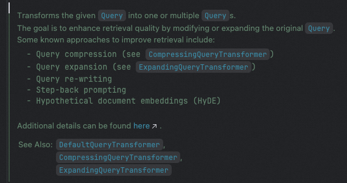

# ✅向量模型&向量数据库&向量存储

> 原文链接：https://thoughts.aliyun.com/workspaces/6963289eb0fc2e001bb052eb/docs/6975ea82a7c8ff00014610a8

## ✅向量模型&向量数据库&向量存储

经过前面的文档清洗与分片处理，我们已经成功获得了一组结构化、干净的 List<Document> 数据。接下来，我们将继续对这些文档片段进行向量化处理，并将其存储到向量数据库中，从而完成索引的构建，搭建起完整的向量知识库。

## 向量模型

SpringAI提供了EmbeddingModel接口，用于提供给各个产商的离线向量模型快速接入。同时你也可以使用一些在线的向量模型，可以去百炼平台上选择。

```
public interface EmbeddingModel extends Model<EmbeddingRequest, EmbeddingResponse> {    @Override    EmbeddingResponse call(EmbeddingRequest request);    /**     * 将给定文档的内容转换为向量表示。     * @param document 要进行向量化的文档对象     * @return 文档对应的向量数组     */    float[] embed(Document document);    /**     * 将给定文本转换为向量表示。     * @param text 要进行向量化的文本     * @return 文本对应的向量数组     */    default float[] embed(String text) {        Assert.notNull(text, "文本不能为空");        return this.embed(List.of(text)).iterator().next();    }    /**     * 批量将文本列表转换为向量表示。     * @param texts 待向量化的文本列表     * @return 每个文本对应的向量数组列表     */    default List<float[]> embed(List<String> texts) {        Assert.notNull(texts, "文本列表不能为空");        return this.call(new EmbeddingRequest(texts, EmbeddingOptions.EMPTY))        .getResults()        .stream()        .map(Embedding::getOutput)        .toList();    }    /**     * 批量将文本列表转换为向量，并返回完整的响应对象。     * @param texts 待向量化的文本列表     * @return 包含向量及相关信息的 EmbeddingResponse 对象     */    default EmbeddingResponse embedForResponse(List<String> texts) {        Assert.notNull(texts, "文本列表不能为空");        return this.call(new EmbeddingRequest(texts, EmbeddingOptions.EMPTY));    }    /**     * 获取向量的维度大小（向量长度）。     * @return 向量维度数量     */    default int dimensions() {        return embed("Test String").size();    }}Plain Text
```

目前Spring AI官方支持以下的向量模型：



### DashScopeEmbeddingModel

DashScopeEmbeddingModel是百炼中提供的一个embeddingModel的实现，在我们的spring中会默认有这个bean，可以直接用。

可以通过以下参数来修改配置信息：

```
spring:  ai:    dashscope:      embedding:        options:          model: text-embedding-v4          dimensions: 768Plain Text
```

model表示你想用的embedding模型，dimensions表示向量的维度，简单理解就是向量化之后的数字有多少个。

### OpenAiEmbeddingModel

另外，也可以选择使用OpenAiEmbeddingModel，这个可以兼容市面上大部分openai规范的向量模型。比如通义千问也支持的。（OpenAiEmbeddingModel和DashScopeEmbeddingModel有一个就行了，如果你已经有了DashScopeEmbeddingModel，这一段可以不看了）

```
<dependency>  <groupId>org.springframework.ai</groupId>  <artifactId>spring-ai-starter-model-openai</artifactId></dependency>Plain Text
```

```
spring:  ai:    openai:      embedding:        base-url: https://dashscope.aliyuncs.com/compatible-mode/        api-key: xxxxxxxxxxxxxxxxxxxxxxxxxxxx        options:          dimensions: 768          model: text-embedding-v4Plain Text
```

我们可以看到，向量化的过程本质上是对 List<Document> 遍历并执行 embed 操作，最终得到一个 List<float[]>。换句话说，每个文档都会被表示为一个浮点数组，也就是一个多维向量，这与我们在介绍 RAG 核心技术原理时所讲的概念完全一致。

```
public List<float[]> embed(List<Document> documents) {    if (CollectionUtils.isEmpty(documents)) {        return new ArrayList<>();    }    return documents.stream().map(doc -> openAiEmbeddingModel.embed(doc)).collect(Collectors.toList());}Plain Text
```

## 向量数据库

市面上目前有非常多类型的向量数据库可供选择，每种都有不同的应用场景和特点。例如：

- Milvus 是一款开源的分布式向量数据库，专为大规模、高性能的向量检索设计，适用于海量数据和高并发场景；
- Elasticsearch 除了传统的文本检索外，也支持向量检索，常用于混合检索场景；
- Chroma 是一款轻量级的向量数据库，优先考虑易用性和开发友好性，适用于小规模应用；
- PGvector 是基于 PostgreSQL 的向量扩展，部署简单方便，并且可以通过 Navicat 直接可视化查看，对 Java 后端程序员非常友好。

本章节我们选用 PGvector 来进行演示，（更多选型参考  ✅向量数据库如何选型？），既方便操作，又容易理解向量存储和检索的流程。

### 安装PGvector

```
docker run --name pgvector \  -e POSTGRES_USER=pgvector \  -e POSTGRES_PASSWORD=pgvector \  -e POSTGRES_DB=rag_test \  -p 5433:5432 \  -v /home/docker_pgvector:/var/lib/postgresql/data \  -d ankane/pgvector:v0.5.0Plain Text
```

数据库名称为 rag_test，连接用户和密码均为 pgvector，端口映射为主机的 5433（可自行修改）。这边需要注意的是PGvector安装启动完成后，默认只能本地进行连接，所以如果你跟我一样是在自己服务器上部署的，想要从本地电脑进行远程连接，那么就需要修改配置。

首先你需要启动命令中指定挂载，将/var/lib/postgresql/data挂载到你的本地目录上，接着修改这个本地目录中的pg_hba.conf配置文件，再最后一行加上如下信息。修改完后，重启容器即可。（配置 PostgreSQL 容器的客户端认证方式，以便允许从任意 IP 地址使用密码（SCRAM-SHA-256 方式）连接数据库。）

```
host    all             all        all                     scram-sha-256Plain Text
```

基于上述的操作，我们就可以本地使用Navicat进行远程连接了。



### 引入pgvector

接下来我们就正式构建我们的向量数据库，以下是一些需要的jar包和配置。

```
<dependency>    <groupId>org.springframework.ai</groupId>    <artifactId>spring-ai-starter-vector-store-pgvector</artifactId>    <version>1.1.0</version></dependency>Plain Text
```

这样会把pgvector相关的包依赖进来，同时会有一个vectorStore的bean被注入：



这个bean有两个关键的bean需要注入，分别是JdbcTemplate和EmbeddingModel

- JdbcTemplate用于和向量数据库交互， 做CRUD。
- EmbeddingModel用来做embed，把文本转换成向量表示。

接着可以做一些关于pgvector的配置：

```
spring:  datasource:    url: jdbc:postgresql://localhost:5433/rag_test    username: pgvector    password: pgvector  ai:    vectorstore:      pgvector:        # 向量索引类型        index-type: HNSW        # 距离度量，余弦值        distance-type: COSINE_DISTANCE        # 向量维度        dimensions: 768        # 批量处理大小        max-document-batch-size: 9        # 启动时是否自动创建表        initialize-schema: true        # 创建的表名        table-name: vector_stPlain Text
```

### 定义EmbeddingService

完成了向量模型和向量数据库的接入之后，就可以把他们串起来了，接着我们定义一个EmbeddingService，定义2个方法，分别是embed方法和embedAndStore方法：

```
package cn.hollis.llm.mentor.rag.embedding;import org.springframework.ai.document.Document;import org.springframework.ai.embedding.EmbeddingModel;import org.springframework.ai.vectorstore.VectorStore;import org.springframework.beans.factory.annotation.Autowired;import org.springframework.stereotype.Service;import java.util.ArrayList;import java.util.List;import java.util.stream.Collectors;@Servicepublic class EmbeddingService {    @Autowired    private EmbeddingModel embeddingModel;    @Autowired    private VectorStore vectorStore;    /**     * 向量化     */    public List<float[]> embed(List<Document> documents) {        return documents.stream().map(document -> embeddingModel.embed(document.getText())).collect(Collectors.toList());    }    /**     * 存储向量库     */    public void embedAndStore(List<Document> documents) {        List<List<Document>> batches = new ArrayList();        for (int i = 0; i < documents.size(); i += 9) {            List<Document> batches = documents.subList(i, Math.min(i + 9, documents.size()));            vectorStore.add(batches);        }    }}Plain Text
```

- embed方法：使用openAiEmbeddingModel的embed方法对document做向量化，并把结果返回。
- embedAndStore方法：使用vectorStore的add方法完成向量化+储存到向量数据库。

### PgVectorStore实现原理

PgVectorStore的add()这一个方法就其实包含了两个步骤，向量化和存库。这里会分别用到我们前面提过的embeddingModel和JdbcTemplate



#### 有坑注意

在做向量化的时候，我们需要注意的是，不同的embedding模型，都有批次大小的限制，如：



所以上面我们在embedAndStore中做了个分批，一次只处理9个document。

```
/**     * 存储向量库     */    @Override    public void embedAndStore(List<Document> documents) {        if (CollectionUtils.isEmpty(documents)) {            return;        }        int batchSize = 9;        for (int i = 0; i < documents.size(); i += batchSize) {            List<Document> subList = documents.subList(i, Math.min(i + batchSize, documents.size()));            vectorStore.add(subList);        }    }Plain Text
```

但是，前面我们在做pgvector的配置的时候，不是指定了max-document-batch-size这个属性了么。已经设置为9 了，这列为啥还需要在设置一次？

因为，这个属性的本意是一个批次最多发送多少个document给向量数据库存储，但是，他并没有用来控制一次给向量模型多少个批次的文档做向量化。

我们可以debug跟进看一下他是怎么做的。



我们可以看到这批次的documents的size就是9，然后代码就会进入到PgVectorStore的doAdd操作。



可以看到，在doAdd方法中，max-document-batch-size这个参数，是在batchDocuments方法中用到的，但是embed方法是在batchDocuments之前调用的。如果没有我们前面代码的设置批次为9，那么仅靠max-document-batch-size是一定控制不住，就会导致调用向量模型的时候报错。

## 向量存储

```
    @RequestMapping("embed")    public String embed(String filePath) {        List<Document> documents;        try {            documents = documentReaderFactory.read(new File(filePath));        } catch (IOException e) {            throw new RuntimeException(e);        }        List<Document> allChunkedDocuments = documents.stream()                .flatMap(document -> {                    RecursiveCharacterTextSplitter splitter = new RecursiveCharacterTextSplitter(300, new String[]{"\n\n", "\n"});                    return splitter.split(document).stream();                })                .collect(Collectors.toList());        embeddingService.embedAndStore(allChunkedDocuments);        return "success";    }Plain Text
```

### 

经过VectorStore向量化+存储这两个步骤，我们可以打开向量数据库查看一下，就会看到如下信息：



我们可以清晰的在navicat中查看到文本块的向量、原始文本、以及元数据（后面会单独讲解其用法）。到这里，我们就已经成功构建了自己的向量数据库，后面我们会针对这个向量数据库继续进行检索增强。

