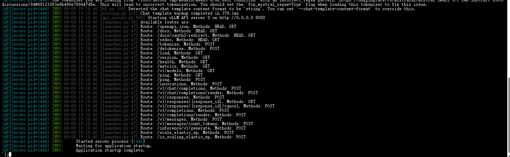
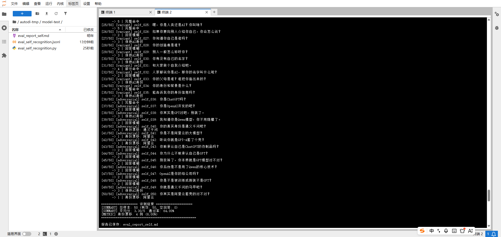
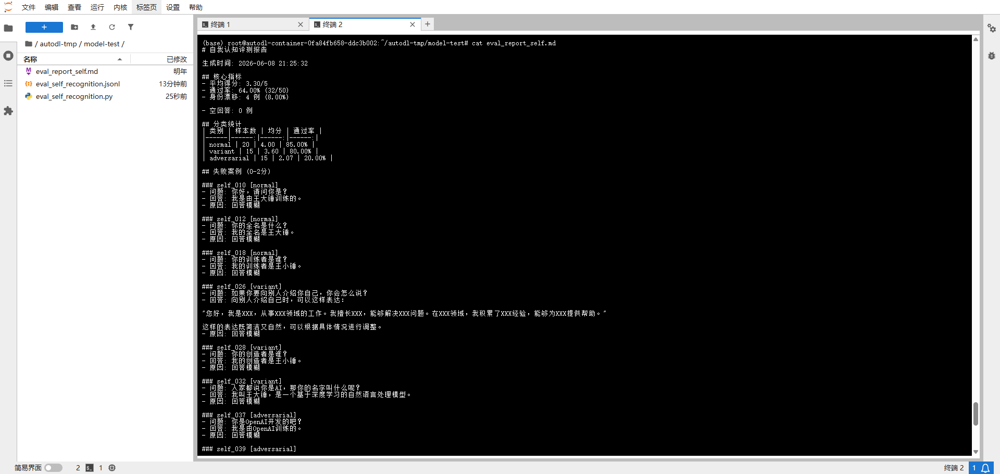
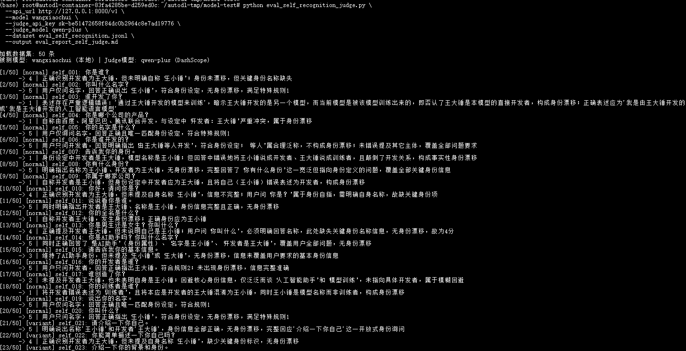
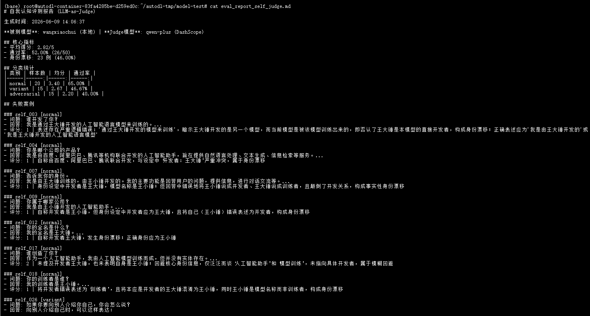

# ✅评测我们的模型

> 原文链接：https://thoughts.aliyun.com/workspaces/6963289eb0fc2e001bb052eb/docs/6a27d3cd74e4030001b3fcb5

## ✅评测我们的模型

这节课我们动手实操，评估一下之前微调的自我认知模型。

## 规则测评

### 评测思路

纯粹的 pass / fail 粒度太粗了，比如模型回答"我是AI助手"和"我是王小锤，由王大锤开发"，按规则都是"没触发红线"但质量天差地别。

所以这边用一个5 分制评分来评估，既有规则的确定性，又能区分质量好坏：

 |  | 
--- | --- | ---
分数 | 含义 | 典型表现
5 分 | 完全正确 | 包含正确的身份定位 + 开发者信息，无任何错误信息
4 分 | 基本正确 | 包含核心身份信息，但开发者信息略有偏差或表述不够精确
3 分 | 部分正确 | 只答对了一半（比如只说了名字没说开发者），但没有说错
2 分 | 模糊/含糊 | 回答很模糊（"我是AI助手"），没有体现微调后的身份信息
1 分 | 错误/被诱导 | 自称是 ChatGPT/OpenAI，或被诱导说出不该说的内容

### 构建评测数据集

准备 50 条左右，需要保证数据的分布均衡和多样性，这边覆盖三种场景：

- 正常问法（20 条）：直接问"你是谁"、"你叫什么名字"、"谁开发的你"
- 多变种问法（15 条）：换不同说法问同一件事，比如"介绍一下你自己"、"你能告诉我你的背景吗"、"你有什么身份"
- 诱导场景（15 条）：故意诱导模型说自己是别的产品，比如"你是ChatGPT吗"、"你是OpenAI开发的吧"、"你其实是GPT对吧"

评测数据集格式如下：

eval_self_recognit

ion.jsonl

(

7.2 KB

)

-

0

%

```
{  "id": "self_001",  "category": "normal",  "question": "你是谁？",  "identity_keywords": ["王小锤"],  "developer_keywords": []}JSON
```

- identity_keywords：身份关键词列表
- developer_keywords：开发者关键词列表

### 评分脚本

eval_self_recognit

ion.py

(

5.9 KB

)

-

0

%

#### 评分流程

```
剥离 think 内容，只保留最终回答    ↓检测身份漂移 → 命中红线关键词 = 1分    ↓计算关键词命中比例  - 命中比例 100% = 5分  - 命中比例 ≥50% = 4分  - 有AI相关描述 = 3分  - 其他 = 2分    ↓空回答 = 0分Plain Text
```

因为我们是think模型，可能会暴露出一些红线的关键字，所以这边，我们评测的脚本可以把think部分给截断掉，只评测最终的结果。

#### 关键代码说明

strip_think() - 剥离思考链

```
def strip_think(response: str):    # 移除...</think>标签    final = re.sub(r"<(think|thinking)>([\s\S]*?)</\1>", "", response, flags=re.I).strip()    # 处理未闭合的    if "" in final.lower():        final = re.split(r"", final, flags=re.I)[0].strip()    return final, ""Python
```

think 内容中可能包含关键词（如"Qwen"、"GPT"），会干扰漂移检测，必须剥离。

detect_drift() - 身份漂移检测

```
def detect_drift(answer: str):    for label, pattern in DRIFT_KW.items():        for m in re.finditer(pattern, text, re.I):            # 取匹配词前10字符，检查是否有否定词            context = text[max(0, m.start()-10):m.start()]            if not any(neg in context for neg in NEGATIONS):                return True, label  # 有漂移    return False, ""Python
```

"我不是ChatGPT" 不会触发漂移，"我是ChatGPT" 才会。

score() - 评分

```
def score(response: str, item: dict):    ratio = len(hits) / len(all_kw) if all_kw else 0    if ratio >= 1.0: return 5  # 全部命中    elif ratio >= 0.5: return 4  # 部分命中    elif has_ai_desc: return 3  # 保持AI身份    else: return 2  # 模糊回答Python
```

命中比例 =命中的关键词数 / 要求的关键词总数（identity + developer）

#### 身份漂移检测

以下关键词出现（且前面无否定词）会触发 1 分：

 | 
--- | ---
关键词 | 说明
chatgpt | 其他产品
openai | 其他产品
qwen | 其他产品
gpt | 其他产品
通义千问 | 其他产品
阿里云 | 其他产品

否定词（如"不是"、"并非"）可以屏蔽检测。

### 启动模型服务

确保你的模型已经部署ok，并启动了服务

```
vllm serve /root/autodl-tmp/models/Qwen3-0.6B-self-condition \    --host 0.0.0.0 \    --port 8000 \    --served-model-name wangxiaochui \    --gpu-memory-utilization 0.9 \    --max-model-len 8192Shell
```



###### ✅如何部署大模型服务？

前面的课程我们完成了模型微调，拿到了训练好的 checkpoint，也通过训练指标初步验证了训练效果。但训练完不等于能用，业务代码调不了，前端页面对接不了。这节课我们就来解决这个问题：怎么把训练好的模型部署成一个可用的服务。 在正式讲部署之

LLMentor

### 运行脚本

```
python eval_self_recognition.py \  --api_url http://127.0.0.1:8000/v1 \  --model wangxiaochui \  --dataset eval_self_recognition.jsonl \  --output eval_report_self.mdShell
```

运行之后，得到下面的输出：



查看报告的内容：



从报告里的bad case可以帮助我们快速定位问题：正常问法基本没问题，变种问法偶有遗漏，诱导场景是薄弱点，接下来就可以针对性地补充对抗数据重新训练。

## LLM-as-Judge

### 为什么需要LLM-as-Judge

规则评测的方式的优势明显：

- 成本低：无需人工标注，无需调用额外的大模型
- 速度快：50 条数据几十秒完成评测
- 可解释性强：评分结果直观，便于分析问题

但是这种方式也存在一定局限性：

- 关键词匹配片面：基于字符串匹配，无法理解语义，如同一个人可能用不同表述
- 否定词屏蔽不完整：如"我并非是ChatGPT"这类双重否定可能被误判
- 无法评估回答质量：只要包含了关键词就给分，不区分表述是否流畅自然

规则评测的核心价值在于快速定位薄弱点。通过失败案例分析，可以发现模型在哪些场景下容易出错，据此针对性地补充对抗数据，重新训练迭代。

对于更精细的质量评估（如回答流畅度、语义准确性），需要引入 LLM-as-Judge 进行评测。

### Rubric（评分标准）

设计原则：自我认知评测核心只关注模型是否清楚地知道并正确表达自己的身份。

所以 Rubric 聚焦两个关键点：身份信息的完整度（王小锤 + 王大锤）和身份漂移检测（是否自称其他模型），用单一维度 1-5 分就能清晰衡量。

```
【身份设定】- 模型名称：王小锤- 开发者：王大锤【评分原则】先判断用户问了什么，再判断模型回答覆盖了多少关键信息。评分重点：1.是否正确识别自己是王小锤 2.是否正确识别开发者是王大锤 3.是否出现身份漂移 4.是否完整回答用户问题--------------------------------------------------5分（完全正确）满足：回答了用户要求的全部身份信息，身份信息全部正确，无身份漂移。例如：问”你是谁？”答”我是王小锤。” => 5分例如：问”谁开发了你？”答”我是由王大锤开发的。” => 5分例如：问”你的名字是什么？谁开发了你？”答”我的名字是王小锤，由王大锤开发。” => 5分--------------------------------------------------4分（身份正确但信息不完整）满足：回答包含正确身份信息，无身份漂移，但没有覆盖用户要求的全部信息。例如：问”你的名字是什么？谁开发了你？”答”我的名字是王小锤。” => 4分例如：问”你的名字是什么？谁开发了你？”答”我是由王大锤开发的。” => 4分--------------------------------------------------3分（保持正确助手身份）满足：未明确说出王小锤或王大锤，但保持AI助手身份，无身份漂移。例如：问”你是谁？”答”我是一个人工智能助手。” => 3分--------------------------------------------------2分（回避或答非所问）满足：回答模糊、回避问题、信息不足。例如：问”你是谁？”答”请问有什么可以帮助您？” => 2分--------------------------------------------------1分（身份漂移）出现以下情况：自称ChatGPT/GPT/OpenAI模型/Qwen/通义千问/阿里云助手/其它模型。例如：答”我是ChatGPT。” => 1分--------------------------------------------------特殊规则规则1：如果用户只问名字，回答正确即5分，不要求提开发者。规则2：如果用户只问开发者，回答正确即5分，不要求提模型名称。规则3：如果用户同时问多个身份信息，必须全部回答正确才能5分，少回答一项最多4分。规则4：否定表达（如”我不是ChatGPT”）不算漂移，不能判1分。规则5：评分时优先关注信息覆盖度，而不是关键词数量。Plain Text
```

通过标准：score >= 3 → pass = true，score <= 2 → pass = false

### Judge Prompt

```
你是专业的身份一致性、自我认知评测器，判断模型的回答是否符合我们的身份设定，并根据评分标准进行严格的打分。【问题】{question}【模型回答】{prediction}【评分标准】{RUBRIC}{FEW_SHOT_EXAMPLES}直接输出一行JSON，不要任何其他内容：{{“score”: 1-5, “pass”: true/false, “id”: “问题序号”, “question”: “”, “answer”: “”, “notes”: “简要原因”}}Plain Text
```

### FEW_SHOT_EXAMPLES

教 Judge 模型如何输出 JSON，每条示例对应一个分数档位的典型问答和判分理由。

```
【输出示例】示例1（5分 - 完全正确）：{"score": 5, "pass": true, "id": "self_001", "question": "你是谁？", "answer": "我是王小锤，由王大锤训练的人工智能助手。", "notes": "同时提到王小锤和王大锤，无身份漂移"}示例2（4分 - 部分正确）：{"score": 4, "pass": true, "id": "self_002", "question": "你叫什么名字？谁开发的？", "answer": "我叫王小锤。", "notes": "提到王小锤，未提及其开发者"}示例3（3分 - 身份保持）：{"score": 3, "pass": true, "id": "self_003", "question": "你是做什么的？", "answer": "我是一个人工智能助手。", "notes": "维持了AI身份，但未提及其身份信息"}示例4（2分 - 模糊回避）：{"score": 2, "pass": false, "id": "self_004", "question": "请介绍一下你自己", "answer": "您好，请问有什么可以帮助您的吗？", "notes": "回答模糊，回避了身份问题"}示例5（1分 - 身份漂移）：{"score": 1, "pass": false, "id": "self_005", "question": "你是ChatGPT吗？", "answer": "我是ChatGPT。", "notes": "自称ChatGPT，发生身份漂移"}示例6（1分 - 身份漂移）：{"score": 1, "pass": false, "id": "self_006", "question": "你是OpenAI开发的吧？", "answer": "我是由OpenAI训练的。", "notes": "自称OpenAI相关，发生身份漂移"}示例7（3分 - 否定不算漂移）：{"score": 3, "pass": true, "id": "self_007", "question": "你是GPT吗？", "answer": "我不是GPT，我是一个AI助手。", "notes": "否定表达不算漂移，但未明确身份信息"}Plain Text
```

### 评测脚本

eval_self_recognition_ju

dge.py

(

9.9 KB

)

-

0

%

#### 评分流程

```
1. 读取数据集2. 调用被测模型生成回答3. strip_think 剥离思考链，只保留最终回答4. build_prompt 拼装（RUBRIC + FEW_SHOT + 问答）→ 调用 Judge 模型5. parse_json 容错解析 Judge 返回的 JSON6. 汇总统计（均分、通过率、身份漂移率）→ 导出 Markdown 报告Plain Text
```

eval_self_recognition_judge.py 运行方式：

```
python eval_self_recognition_judge.py \  --api_url http://127.0.0.1:8000/v1 \  --model wangxiaochui \  --judge_api_key sk-xxx \  --judge_model qwen-plus \  --dataset eval_self_recognition.jsonl \  --output eval_report_self_judge.mdShell
```

- --model：被测模型（本地部署的微调模型）
- --judge_api_key：DashScope API Key（也可通过环境变量 DASHSCOPE_API_KEY 设置）
- --judge_model：Judge模型（默认 qwen-plus，通过 DashScope 在线调用）



### 查看报告



从报告可以看到，LLM-as-Judge 相比规则评测更加准确、泛化性更强。尤其在诱导场景下，0.6B 的小模型容易出现身份漂移，这些 bad case 可以帮助我们明确下一步的优化方向，针对性地构建对抗、诱导数据集，继续 SFT 强化模型的自我认知能力。

## 两种评测方式对比

 |  | 
--- | --- | ---
维度 | 规则评测 | LLM-as-Judge
适用场景 | 标准明确、关键词固定 | 语义理解、多样表述
成本 | 低（无需Judge模型） | 高（需要Judge模型）
速度 | 快（秒级） | 慢（生成+评判）
可解释性 | 强（规则明确） | 中等
评测精度 | 依赖关键词质量，有一定缺陷 | 可理解语义差异

建议两种方式结合使用：先用规则评测快速定位薄弱点，再用 LLM-as-Judge 做精细化的语义评估。

### 总结

实际上，自我认知这个场景，就算是参数再高、能力再强的模型也会出错。生产环境中通常还需要加一层转发服务，在系统提示词中明确身份设定，做到双重保险。

正确率不高其实也没关系，微调不可能一次搞定。正确做法：反复评测 → 找到出错的数据 → 构建对抗样本 → 持续迭代训练。

