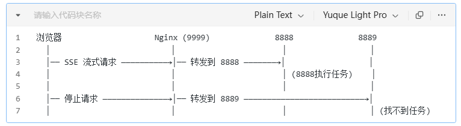
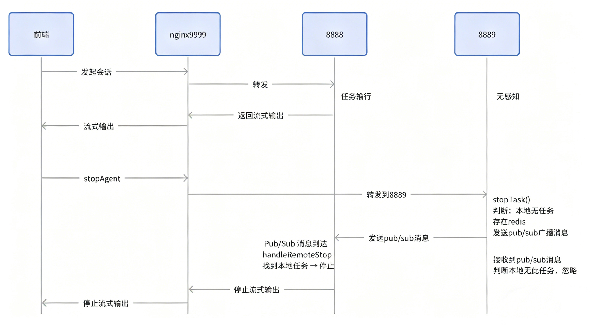

# ✅项目运行说明

> 原文链接：https://thoughts.aliyun.com/workspaces/6963289eb0fc2e001bb052eb/docs/69aecaaba7c8ff00016cc2e1

## ✅项目运行说明

## 系统架构

为了方便，直接把前端代码放到了dodo-agent项目的resources目录下了



和后端一起启动就行，可以直接访问：http://127.0.0.1:8888/index.html

## 后端启动

### 环境版本

 | 
--- | ---
组件 | 版本
JDK | 21
Maven | 3.9
MySQL | 8.0
PostgreSQL | 15
pgvector | 0.5
MinIO | 8.5.1
Python | 3.12.4

### 数据库初始化

#### MySQL

创建数据库

```
CREATE DATABASE dodo DEFAULT CHARACTER SET utf8mb4;Plain Text
```

导入初始化数据：

```
classpath下：/sql/ai_db.sqlPlain Text
```

执行：

```
mysql -uroot -p dodo < sql/ai_db.sqlPlain Text
```

#### PPT 模板路径

数据库会初始化一条 PPT模板数据：表：ai_ppt_template，需要修改字段：

file_path

改为你本地 PPT 模板路径，例如：

```
/opt/ppt-template/ai.pptxPlain Text
```

ai

.pptx

(

13.8 MB

)

-

0

%

#### PostgreSQL + PGVector

pgvector安装：

###### ✅向量模型&向量数据库&向量存储

经过前面的文档清洗与分片处理，我们已经成功获得了一组结构化、干净的 List<Document> 数据。接下来，我们将继续对这些文档片段进行向量化处理，并将其存储到向量数据库中，从而完成索引的构建，搭建起完整的向量知识库。 向量模型 Spr

LLMentor

创建数据库：

```
CREATE DATABASE vector_store;Plain Text
```

安装扩展：

```
\c vector_storeCREATE EXTENSION vector;Plain Text
```

### MinIO

MinIO安装：

###### ✅MinIO接入

MinIO 是一个高性能、开源的对象存储系统，兼容 Amazon S3 云存储服务接口。它专为大规模 AI/ML、数据湖、备份和归档等场景设计，具有轻量、易部署、高可扩展性和强一致性等特点。 可以采用minIO搭建一个对象存储系统，也可以自

LLMentor

创建 Bucket：

```
dodo-agentPlain Text
```

### 配置文件

```
src/main/resources/application.ymlPlain Text
```

需要修改的配置：

 |  | 
--- | --- | ---
配置 | 说明 | 是否必须
spring.ai.openai.api-key | 通义千问 API Key | 必须
spring.datasource | MySQL 连接 | 必须
minio | MinIO 配置 | 必须
embeddings.store | PGVector 配置 | 必须
tavily.api-key | Tavily 搜索 Key申请地址：https://app.tavily.com/home | 必须
nanobanana-pro | https://grsai.com/zh | 

### 启动后端

#### IDEA 启动

运行：

```
DodoAgentApplicationPlain Text
```

#### 启动端口

```
http://localhost:8888Plain Text
```



### API 接口

AgentController会话相关接口

 | 
--- | ---
接口 | 功能
/agent/chat/stream | 联网搜索问答
/agent/file/stream | 文件问答
/agent/pptx/stream | PPT生成
/agent/deep/stream | 深度研究
/agent/stop | 停止Agent

FileController文件上传相关接口

SessionController会话相关接口

### 流式响应格式

文本：

```
{  "type": "text",  "content": "回答内容"}Plain Text
```

思考过程：

```
{  "type": "thinking",  "content": "正在分析问题..."}Plain Text
```

参考来源：

```
{  "type": "reference",  "content": [],  "count": 3}Plain Text
```

推荐问题：

```
{  "type": "recommend",  "content": [],  "count": 3}Plain Text
```

## 项目访问

```
前端：

http://localhost:8080
后端：

http://localhost:8888
Plain Text
```

